# 설치 기사용 안내서: 번호 호출 메뉴판

> POSWING 번호 호출 메뉴판 1차(2026년 12월) 기준 · 인쇄본: [installer-guide.pdf](pdf/installer-guide.pdf)
>
> 이 안내서는 현장에서 순서대로 따라 하는 **그림 안내서**입니다. 명령어와 화면 하나하나의 자세한 절차는 [매장 POS기 설치 안내서(세부 절차)](../install-pos.md)에 있고, 이 안내서의 각 단계에 그 절의 링크를 달았습니다.
>
> 표시: **[준비 중]** 은 아직 시험 중이라 1차 납품 전에 바뀔 수 있는 기능입니다.

## 목차

1. [전체 그림](#1-전체-그림)
2. [준비물](#2-준비물)
3. [설치 순서 한눈에](#3-설치-순서-한눈에)
4. [POS기에 메뉴판 서버 설치](#4-pos기에-메뉴판-서버-설치)
5. [네트워크와 방화벽](#5-네트워크와-방화벽)
6. [TV 설치: 천장에 달기 전에 바닥에서](#6-tv-설치-천장에-달기-전에-바닥에서)
7. [천장에 단 뒤: POS기에서 원격으로 설정](#7-천장에-단-뒤-pos기에서-원격으로-설정)
8. [번호 키패드 설치](#8-번호-키패드-설치)
9. [사장님께 인계](#9-사장님께-인계)
10. [문제 해결](#10-문제-해결)
11. [현장 점검표 (복사해서 쓰기)](#11-현장-점검표-복사해서-쓰기)

---

## 1. 전체 그림

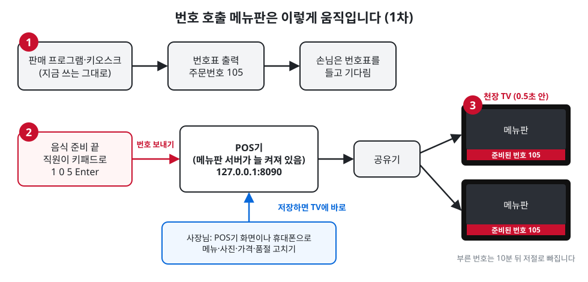

- 판매 프로그램과 키오스크는 **지금 쓰는 그대로** 둡니다. 메뉴판은 판매 프로그램을 바꾸지 않습니다.
- 메뉴판 서버는 POS기 안에서 창 없이 늘 돕니다. 인터넷이 끊겨도 매장 안에서는 그대로 동작합니다.
- TV는 POS기에서 메뉴와 번호를 받아 띄웁니다. TV 앞에 따로 컴퓨터가 없습니다(TV 뒤의 RK3568 보드가 앱을 돌림).
- 메뉴판에서 주문은 받지 않습니다(1차는 번호 호출만).

TV에 나오는 화면은 세 가지입니다. 화면 번호(1~4)마다 하나를 고릅니다.

| 사진 격자 + 번호 띠 | 목록 + 큰 사진 | 번호 전용 |
| --- | --- | --- |
| 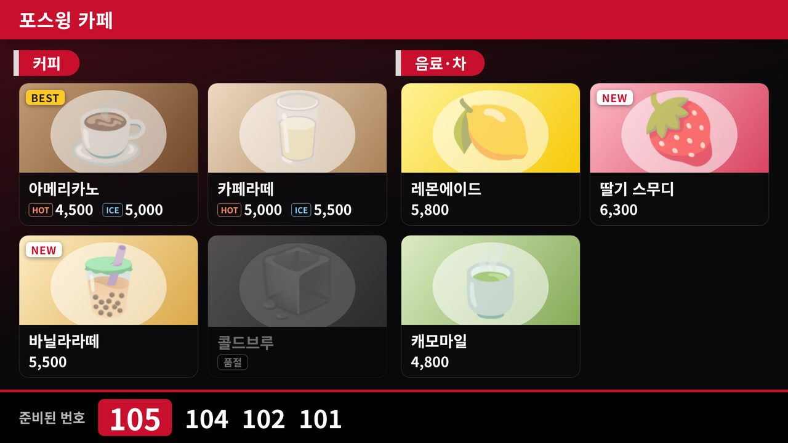 | 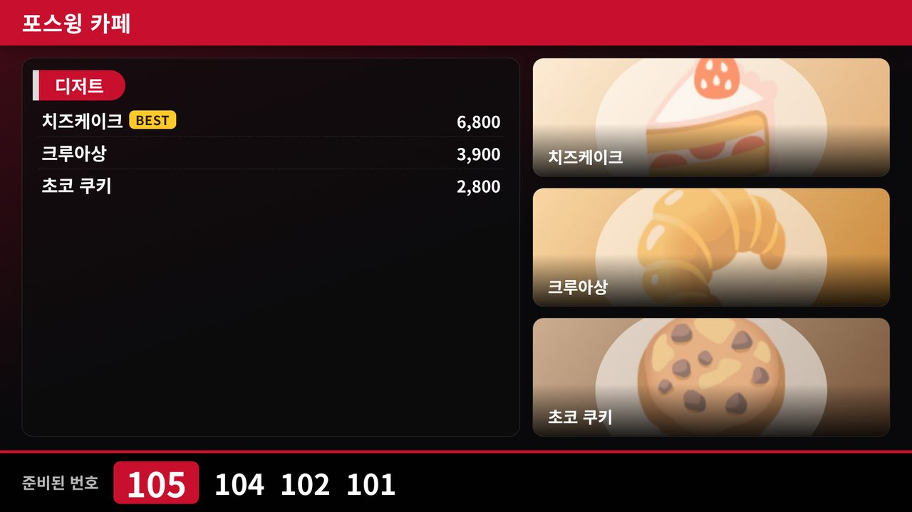 | 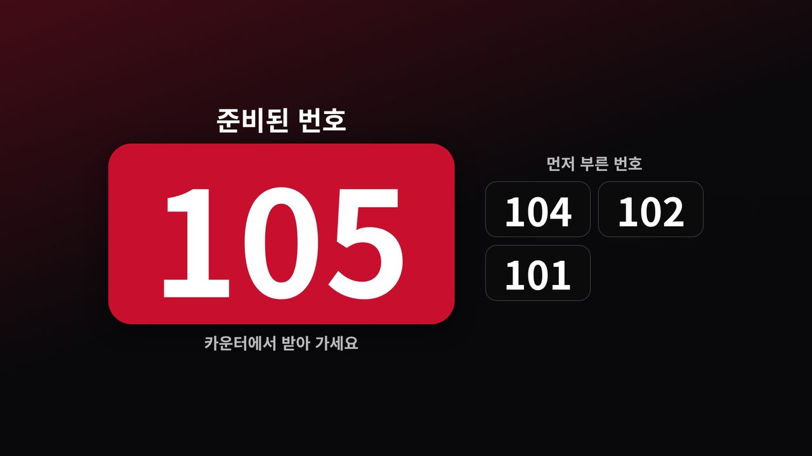 |

---

## 2. 준비물

| 챙길 것 | 확인 |
| --- | --- |
| 배포 묶음 USB (`server`, `board-app`, `order-app` 폴더) | `server` 안에 `pb_data` 폴더나 `.dev-` 로 시작하는 파일이 **없어야** 합니다(다른 매장 데이터). 있으면 설치하지 말고 본사에 알립니다. |
| POS기 Windows 관리자 비밀번호 | 납품 POS기는 Windows 10 Pro |
| 공유기 관리자 비밀번호 | 주소 고정(DHCP 예약)에 필요 |
| TV 앱 설치용 USB 케이블(보드 OTG) 또는 USB 메모리 | 보드 모델에 맞는 것 |
| 랜선(TV 수 + 여유 1) | TV는 되도록 유선 |
| A/S 기록지 | A/S 관리자 비밀번호, TV 위치와 화면 번호 |
| 스티커 2종 | "공유기·인터넷 바꾸기 전 A/S 문의", "아침에 전원만 켜면 메뉴판이 저절로 뜹니다" |
| 화면 번호 라벨 | TV 뒤·아래에 붙일 "화면 1", "화면 2" |
| 사장님용 사용 설명서 인쇄본 | [owner-guide.pdf](pdf/owner-guide.pdf) |
| USB 숫자 키패드 | 키패드 앱은 배포 묶음의 `order-app` 폴더 |

---

## 3. 설치 순서 한눈에

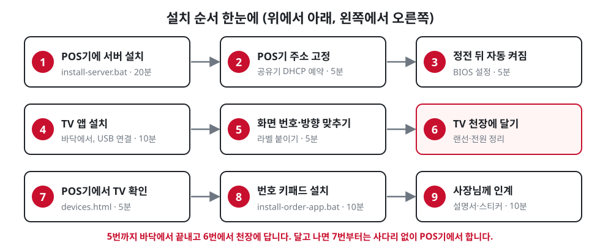

**핵심: TV 앱 설치와 화면 번호·방향 맞추기(4~5)는 TV를 천장에 달기 전에 바닥에서 끝냅니다.** 천장에 단 뒤에는 POS기의 TV 관리 화면으로 손봅니다.

---

## 4. POS기에 메뉴판 서버 설치

자세한 절차: [세부 절차 1~2단계](../install-pos.md#1-서버-설치)

1. USB의 `server` 폴더를 `C:\MenuBoard\` 에 복사합니다. 결과가 `C:\MenuBoard\server\pocketbase.exe` 가 되게 합니다. (바탕 화면·다운로드 폴더는 쓰지 않습니다.)
2. `C:\MenuBoard\server\install-server.bat` 을 더블클릭 → "사용자 계정 컨트롤"에서 **예**.
   - 파란 "Windows의 PC 보호" 창이 뜨면 **추가 정보** → **실행**.
3. `빠른 시작을 끌까요?` 에 `Y` + Enter.
4. 창 아래쪽에서 두 가지를 **A/S 기록지에 옮겨 적습니다.**
   - `TV(보드)에 넣을 서버 주소` 아래의 `192.168.x.x:8090`
   - 노란 글씨 `A/S 관리자 계정` 의 이메일과 비밀번호
5. 아무 키나 눌러 창을 닫습니다(서버는 계속 돕니다). `C:\MenuBoard\server\AS-관리자-비밀번호.txt` 를 지웁니다.

설치 파일이 해 주는 일: 컴퓨터를 켜면 로그인 없이 서버 자동 시작(작업 스케줄러 `MenuBoardServer`), 꺼지면 5초 뒤 다시 켜기, 방화벽 8090 열기(같은 공유기 안만), 절전 끄기, Windows 업데이트 사용 시간 7~24시, Defender 예외.

### 첫 매장 만들기와 확인

1. POS기 브라우저에서 `http://127.0.0.1:8090/admin.html` 을 엽니다.
2. 새 매장이면 아래 화면에서 ① 사장님 이메일 ② 비밀번호(8자 이상) ③ 매장 이름을 넣고 ④ **계정 만들기**를 누릅니다. **비밀번호는 사장님이 직접 넣게 하고, 기사는 적지 않습니다.**

   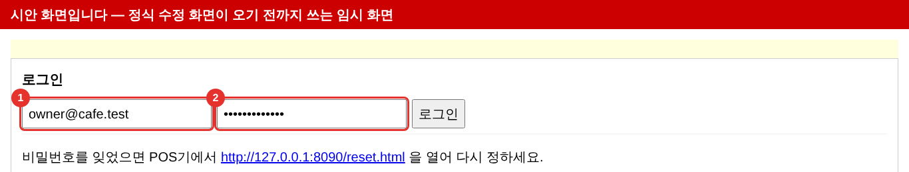

3. 주소창에 `http://127.0.0.1:8090/?screen=1` → 메뉴판이 뜨면 서버는 정상입니다.
4. POS기를 다시 시작하고 **로그인하지 않은 채** 1분 기다린 뒤, 같은 공유기에 붙은 휴대폰 브라우저로 `http://POS기주소:8090/?screen=1` 을 엽니다. 뜨면 자동 실행까지 확인된 것입니다.

### 이어서 할 것 (세부 절차 참고)

| 할 일 | 왜 | 세부 절차 |
| --- | --- | --- |
| 정전 뒤 자동 켜짐(BIOS) | 마감 때 차단기를 내려도 아침에 전원만 들어오면 메뉴판이 뜨게 | [4단계](../install-pos.md#4-정전-뒤-자동으로-켜지게-bios) |
| V3·알약 예외 | 백신이 서버를 악성으로 잘못 보고 지우는 일을 막기 | [5단계](../install-pos.md#5-백신-예외) |
| 손 백업 위치 알려 두기 | POS기 교체·고장 때 메뉴를 살리기 | [8단계](../install-pos.md#8-백업과-되돌리기) |

---

## 5. 네트워크와 방화벽

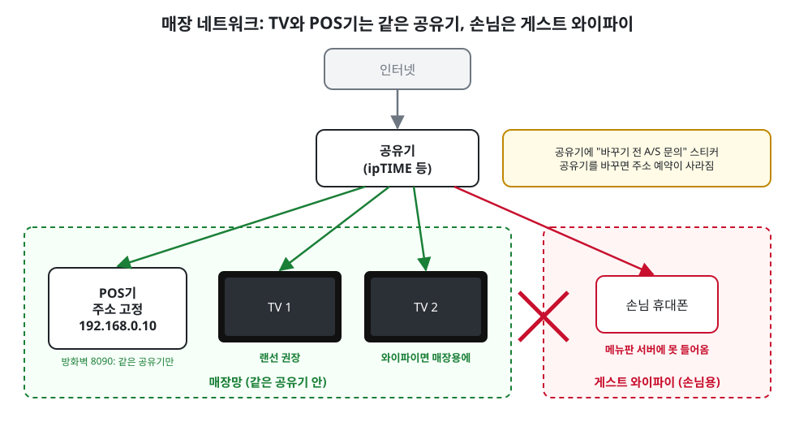

| 할 일 | 방법 | 안 하면 |
| --- | --- | --- |
| **POS기 주소 고정** | 공유기 DHCP 예약(ipTIME: 관리도구 → 고급 설정 → 네트워크 관리 → DHCP 서버 설정). [세부 절차 3단계](../install-pos.md#3-pos기-주소-고정-공유기-dhcp-예약) | 공유기가 POS기 주소를 바꾸면 TV가 서버를 다시 찾느라 몇 분 동안 옛 화면 |
| **TV와 POS기는 같은 공유기** | 공유기 두 대를 이어 쓰는 매장은 같은 쪽에 연결 | 방화벽이 같은 공유기 안만 열어 두어 TV가 못 붙음 |
| **TV는 랜선** | 와이파이를 쓰면 매장용 와이파이(손님용 아님) | 와이파이 비밀번호를 바꾸면 천장 TV가 끊김(사다리 필요) |
| **손님 와이파이 분리** | 공유기 "게스트 네트워크"(ipTIME: 무선 설정/보안 → 게스트 네트워크) | 손님이 같은 망에서 메뉴판 서버에 접근할 수 있음 |
| **공유기 스티커** | "바꾸기 전 A/S 문의" | 사장님이 공유기를 바꾸거나 초기화해 TV가 끊김 |

방화벽은 설치 파일이 8090 포트를 **같은 공유기 안(LocalSubnet)** 에서만 엽니다. 공유기에서 포트 포워딩은 하지 않습니다(인터넷 쪽에 열지 않음).

---

## 6. TV 설치: 천장에 달기 전에 바닥에서

### 6-1. TV 앱 설치

1. 보드를 USB로 POS기(또는 기사 노트북)에 연결합니다.
2. USB의 `board-app\install-board-app.bat` 을 더블클릭합니다. 앱 설치와 함께 부팅 자동 실행, 업데이트 설치, A/S 연결 권한을 줍니다.
   - adb로 연결이 안 되면 APK를 USB 메모리로 옮겨 보드에서 설치하고, 앱 설정 화면의 두 권한 버튼으로 허용합니다. 이때는 원격 A/S 연결 기능이 동작하지 않습니다.
3. **설치가 끝나면 그 TV의 adb는 잠깁니다.** 다시 adb로 붙으려면 POS기 TV 관리 화면에서 A/S 연결을 엽니다(7절).

### 6-2. 서버 연결과 화면 번호

1. TV를 켜면 앱이 같은 공유기의 메뉴판 서버를 스스로 찾아 메뉴판을 띄웁니다.
2. 못 찾으면 설정 화면이 뜹니다. **서버 주소** 칸에 4절에서 적은 주소(예: `192.168.0.10:8090`)를 넣고 **저장하고 메뉴판 보기**.
3. TV마다 **화면 번호**를 정합니다. 예: 카운터 왼쪽 = 1, 오른쪽 = 2, 픽업대 = 3(번호 전용).
   - 리모컨: 메뉴판에서 **확인 버튼 2초** → 설정 화면 → 화면 번호(1~4), 화면 방향(가로·세로), 밝기 → 저장.
   - 설정 화면은 2분 동안 손대지 않으면 저절로 메뉴판으로 돌아갑니다.
4. 세로로 달 TV는 이때 **화면 방향**을 세로로 맞추고 실제 세로 메뉴판이 똑바로 보이는지 봅니다.
5. TV 뒤나 아래에 **화면 번호 라벨**을 붙이고 A/S 기록지에 "위치 = 화면 번호"를 적습니다.

### 6-3. 천장에 달기

- 전원과 랜선을 정리하고, 보드의 USB 단자 하나는 **손이 닿는 쪽**으로 빼 둡니다(현장 비상용 USB 설정 파일, 7절).
- TV 리모컨은 사장님께 카운터 안쪽 보관을 부탁합니다(손님이 입력을 바꾸거나 설정을 건드리지 않게).

---

## 7. 천장에 단 뒤: POS기에서 원격으로 설정

POS기에서 `http://127.0.0.1:8090/devices.html` 을 엽니다(메뉴 수정 화면과 같은 사장님 계정). TV는 15초마다 서버에 알려 오므로 저절로 목록에 나타납니다.

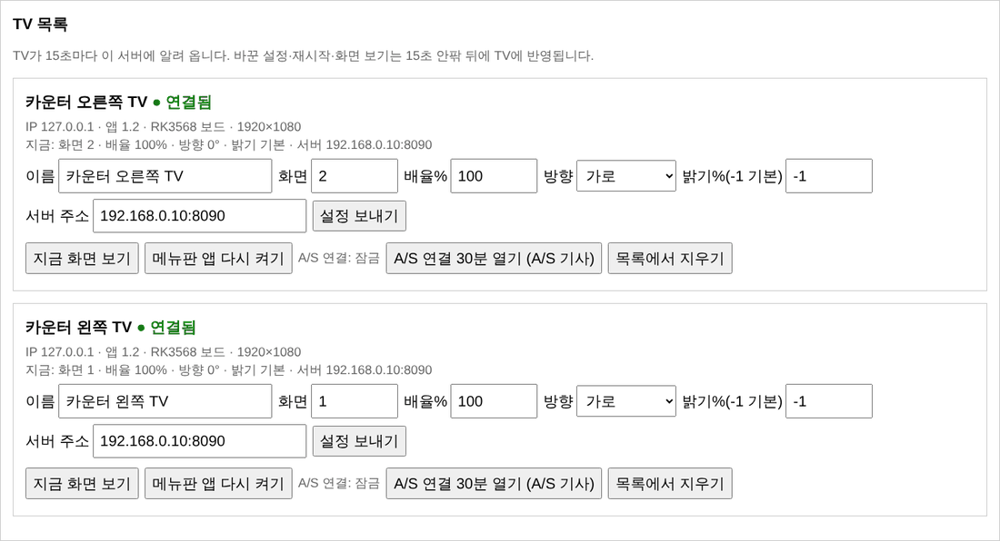

| 하고 싶은 것 | 누를 곳 | 반영 |
| --- | --- | --- |
| TV 이름 바꾸기(예: "카운터 왼쪽 TV") | 이름 칸 → **설정 보내기** | 15초 안팎 |
| 화면 번호·글자 배율·방향·밝기 | 각 칸 → **설정 보내기** | 15초 안팎 |
| 천장 TV가 실제로 뭘 띄우는지 보기 | **지금 화면 보기** | TV가 찍어 올린 사진이 카드에 나옴 |
| 앱이 이상할 때 | **메뉴판 앱 다시 켜기** | 앱만 다시 켬(보드 전체 재부팅은 1차에 없음) |
| adb로 붙어야 할 때 | **A/S 연결 열기** + A/S 관리자 계정 | 정해진 시간만 열리고 스스로 잠김 |
| 모르는 TV 치우기 | **목록에서 지우기** | 그 TV는 다음 보고 때 다시 등록됨 |

- 서버 주소는 TV가 새 주소에 **실제로 붙어 본 뒤에만** 바뀝니다. 못 붙으면 그대로 두고 카드에 알림이 뜹니다.
- 밝기는 화면 위에 검은 막을 덮는 방식입니다(HDMI TV 백라이트는 앱이 못 바꿈). 너무 밝으면 TV 리모컨의 밝기도 함께 봅니다.
- A/S 연결은 기사 휴대폰이 아니라 **POS기에서** 엽니다(관리자 비밀번호가 매장 와이파이로 암호화 없이 가지 않게).
- 출고 보드 펌웨어는 ADB 인증(`ro.adb.secure=1`)이 켜져 있어야 합니다. 꺼진 보드는 A/S 연결이 열린 동안 같은 망의 누구나 TV를 조작할 수 있습니다(보드 업체에 요청 중).

### TV가 목록에 없거나 서버에 못 붙을 때: 사다리는 맨 마지막

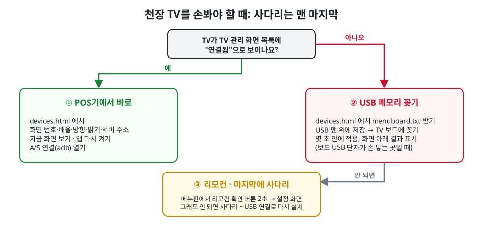

**USB 설정 파일(menuboard.txt)** 은 TV 관리 화면 아래 "USB 설정 파일 만들기"에서 만듭니다.

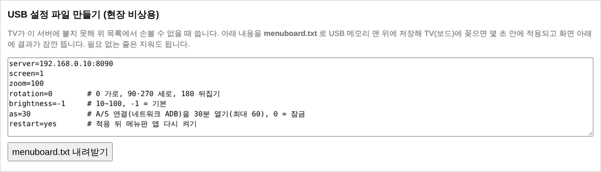

1. 본보기 내용을 **그 TV에 맞게** 고칩니다. 특히
   - `server=` 를 이 매장 POS기 주소로(본보기의 `192.168.0.10` 을 그대로 쓰지 않음)
   - `screen=` 과 `rotation=` 을 그 TV의 화면 번호와 방향으로(세로 TV는 `90` 또는 `270`)
   - adb가 필요 없으면 `as=` 줄을 **지웁니다**(남겨 두면 A/S 연결이 열림)
2. **menuboard.txt 내려받기** → USB 메모리 **맨 위**에 저장합니다. 파일 이름이 `menuboard.txt.txt` 가 되지 않았는지 탐색기에서 "파일 확장명"을 켜고 봅니다.
3. 보드 USB 단자에 꽂으면 몇 초 안에 적용되고 화면 아래에 결과가 잠깐 뜹니다. 아무것도 안 뜨면 파일 이름·위치를 다시 봅니다.

> 위험 점검표 M-25: 본보기를 그대로 쓰면 세로 TV가 가로로 돌고 화면 1이 되며 A/S 연결이 열립니다. "이 TV용 파일 받기" 단추는 준비 중입니다.

---

## 8. 번호 키패드 설치

번호 키패드 앱(`MenuBoardKeypad`)은 POS기 오른쪽 아래에 좁은 창으로 떠 있고, **판매 프로그램을 쓰는 중에도** USB 숫자 키패드의 번호 + Enter 를 받아 TV에 띄웁니다(보통 0.5초 안). 12/1부터 하드웨어 시험(K-1~K-18) 중이라 절차가 조금 바뀔 수 있습니다. 앱의 자세한 내용: `docs/order-app.md`(PR #16).

1. 메뉴판 서버를 먼저 설치합니다(4절).
2. USB 숫자 키패드를 POS기에 꽂습니다.
3. 배포 묶음의 `order-app` 폴더를 `C:\MenuBoard\order-app` 에 복사합니다.
4. **판매 프로그램을 쓰는 Windows 계정**으로 로그인한 채 `install-order-app.bat` 을 더블클릭 → **예**. 로그인할 때마다 저절로 켜지고, 꺼지면 2초 뒤 다시 켜집니다.
   - "관리자 아님" 경고가 나오면 POS기 계정이 표준 사용자입니다. 판매 프로그램이 관리자 권한으로 돌면 키를 못 받을 수 있으니 시험해 봅니다.
5. 처음 뜨는 설정 창에 **POS 연동 키**를 붙여 넣고 **연결 확인** → **저장**.
   - 키는 수정 화면 맨 아래 **POS·키오스크 연동**에 있습니다. 키오스크·POS 연동에 **이미 쓰는 키가 있으면 같은 키**를 넣습니다. **새 연동 키 만들기**를 누르면 예전 키를 쓰던 기기가 바로 끊깁니다. 키는 만들 때 한 번만 보이니 A/S 기록지에 적어 둡니다.

   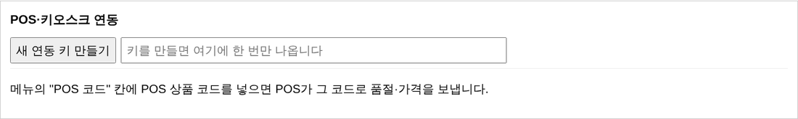

6. 판매 프로그램 입력칸에 커서를 둔 채 키패드로 `1` `2` Enter → TV에 12가 뜨고 **판매 프로그램 칸에는 아무것도 안 들어가는지** 봅니다. Num Lock을 끄고 한 번 더 해 봅니다.
7. `-` Enter Enter 로 12가 TV에서 빠지는지 봅니다.
8. 창을 판매 프로그램의 결제 창을 가리지 않는 구석으로 끌어 둡니다(위치를 기억함).

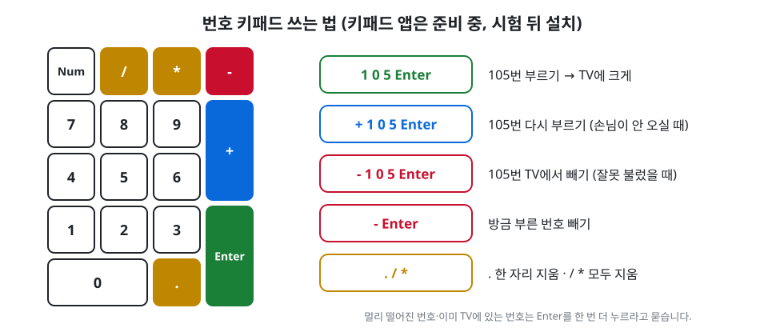

**이런 매장은 설정을 바꿉니다**

| 매장 | 설정 |
| --- | --- |
| 숫자패드 달린 일반 키보드로 판매 프로그램에 숫자를 넣음 | 앱이 키보드를 구별하지 못해 그 숫자패드도 가져갑니다. 설정에서 **숫자패드 키를 이 앱이 받기**를 끄고, 번호는 창의 화면 단추로 부르게 합니다(또는 키보드 위쪽 숫자 줄로 판매 프로그램 입력) |
| 숫자패드 방식 바코드 스캐너 | 위와 같이 번호 창이 가져갑니다. 시험(K-15) 뒤 안내 확정 |
| V3·알약 매장 | 키보드를 읽는 앱이라 백신이 오인할 수 있습니다. `C:\MenuBoard\order-app` 을 예외에 넣습니다(5절 방법과 같음) |

없애기: 관리자 `cmd` 에서 `install-order-app.bat --uninstall`. 기록: `%LOCALAPPDATA%\MenuBoard\keypad.log`

---

## 9. 사장님께 인계

사장님과 함께 POS기 앞에서 아래를 **사장님 손으로** 한 번씩 해 봅니다. (사장님용 사용 설명서를 펴 놓고)

| 해 보기 | 설명서 |
| --- | --- |
| 로그인, 로그아웃 | 1절 |
| 메뉴 하나 가격 바꾸고 **그 줄의 저장** → TV에서 확인 | 4절 |
| 사진 하나 바꾸기(휴대폰 사진) | 4절 |
| 품절 켜기 → TV 확인 → 맨 위 "지금 품절"에서 풀기 | 5절 |
| 키패드로 번호 부르기·다시 부르기·빼기, 수정 화면에서 × 로 빼기 | 3절 |
| 화면 구성의 **미리보기** | 6절 |
| 비밀번호를 잊었을 때 POS기에서 다시 정하기(`reset.html`) 위치만 알려 주기 | 8절 |

마지막으로:

- POS기에 "아침에 전원만 켜면 메뉴판이 저절로 뜹니다" 스티커, 공유기에 "바꾸기 전 A/S 문의" 스티커.
- TV 리모컨은 카운터 안쪽 보관.
- 사장님 휴대폰으로 수정 화면을 쓰려면 **매장 와이파이**에 붙어 있어야 한다는 것(밖에서 고치는 휴대폰 앱은 다음 업데이트).
- A/S 연락처를 설명서 맨 뒤 칸에 적어 드립니다.

---

## 10. 문제 해결

### TV 화면이 이상할 때

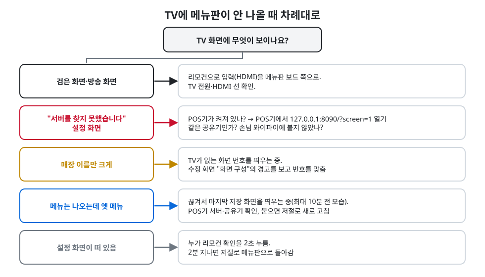

### POS기·설치

| 보이는 것 | 할 일 |
| --- | --- |
| 설치 창에 `다른 프로그램이 8090 포트를 쓰고 있습니다` | 그 프로그램을 끄고 `install-server.bat` 다시 실행. 예전 메뉴판 서버면 그쪽 `uninstall-server.bat` |
| `30초 안에 서버가 응답하지 않습니다` | `C:\MenuBoard\server\logs` 의 오늘 로그 보기. 백신이 `pocketbase.exe` 를 지웠는지 보기 |
| `Defender 예외를 넣지 못했습니다` | V3·알약 매장. [세부 절차 5단계](../install-pos.md#5-백신-예외)대로 직접 |
| POS기 화면에 검은 서버 창 | `start-server.bat` 창입니다. 닫습니다(자동 실행 서버는 창이 없음) |
| 재부팅 뒤 TV가 메뉴판을 못 띄움 | 작업 스케줄러에서 `MenuBoardServer` 가 **실행 중**인지. **준비** 면 오른쪽 단추 → 실행 |
| 사장님 비밀번호 분실 | POS기에서 `http://127.0.0.1:8090/reset.html` (POS기에서만 열림) |
| A/S 관리자 비밀번호 분실 | 관리자 `cmd` 에서 `cd /d C:\MenuBoard\server` → `install-server.bat --reset` |
| 사장님이 메뉴·구역을 잘못 지움 | 되돌리기 단추는 없습니다. 자동 백업(하루 한 번, 7개)에서 되돌립니다: [세부 절차 8단계](../install-pos.md#8-백업과-되돌리기). 되돌린 날 이후 고친 것은 다시 해야 하니 사장님께 먼저 말씀드립니다 |
| POS기 교체 | [세부 절차 8단계 "POS기 교체"](../install-pos.md#8-백업과-되돌리기) |

서버 로그: `C:\MenuBoard\server\logs\server-오늘날짜.log` (14일 보관)

---

## 11. 현장 점검표 (복사해서 쓰기)

```
매장: ______________  날짜: ________  기사: ________

[ ] 배포 묶음 server 폴더에 pb_data · .dev- 파일 없음
[ ] C:\MenuBoard\server 에 복사, install-server.bat 실행
[ ] 서버 주소 기록: 192.168.___.___:8090
[ ] A/S 관리자 비밀번호 A/S 기록지에 기록, AS-관리자-비밀번호.txt 삭제
[ ] 첫 매장 계정(사장님이 직접 비밀번호 입력)
[ ] 재부팅 후 로그인 없이 휴대폰에서 메뉴판 열림
[ ] 공유기 DHCP 예약 (POS기 주소 고정)
[ ] BIOS 정전 복구 = Power On
[ ] V3/알약 예외 (해당 매장만)
[ ] 손님 와이파이 분리(게스트 네트워크)
[ ] TV 앱 설치 (install-board-app.bat), TV 수: ___
[ ] TV별 화면 번호·방향 확인, 라벨 부착
      TV1 위치 ________ 화면 __   TV2 위치 ________ 화면 __
      TV3 위치 ________ 화면 __   TV4 위치 ________ 화면 __
[ ] 천장 설치 후 devices.html 에서 모두 "연결됨", 지금 화면 보기 확인
[ ] 수정 화면 "화면 구성"에 경고 없음 (없는 화면 번호를 띄운 TV 없음)
[ ] 번호 하나 불러 TV 번호 띠 확인 후 빼기
[ ] 키패드 앱 설치, 연동 키 입력(키 기록), 판매 프로그램 쓰는 중 12 Enter → TV, Num Lock 끄고도 확인
[ ] 사장님 인계 7가지, 스티커 2장, 리모컨 보관 안내
```
