# 사장님용 사용 설명서: 번호 호출 메뉴판

> POSWING 번호 호출 메뉴판 1차(2026년 12월) 기준 · 인쇄본: [owner-guide.pdf](pdf/owner-guide.pdf)
>
> 지금 수정 화면은 **시안 화면**입니다(화면 맨 위 빨간 띠). 정식 화면으로 바뀌어도 칸과 단추의 이름은 거의 같게 둡니다. **[준비 중]** 표시는 다음 업데이트로 들어올 기능입니다.

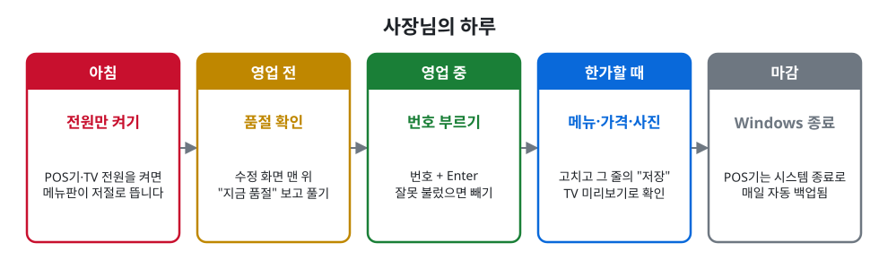

## 목차

1. [수정 화면 열기](#1-수정-화면-열기)
2. [화면 생김새](#2-화면-생김새)
3. [번호 부르기](#3-번호-부르기)
4. [메뉴·사진·가격 바꾸기](#4-메뉴사진가격-바꾸기)
5. [품절](#5-품절)
6. [구역과 TV 화면 구성](#6-구역과-tv-화면-구성)
7. [자주 하는 실수와 되돌리기](#7-자주-하는-실수와-되돌리기)
8. [비밀번호를 잊었을 때](#8-비밀번호를-잊었을-때)
9. [TV가 이상할 때](#9-tv가-이상할-때)
10. [이것만은 하지 마세요](#10-이것만은-하지-마세요)
11. [A/S 연락](#11-as-연락)

---

## 1. 수정 화면 열기

| 어디서 | 브라우저 주소창에 |
| --- | --- |
| POS기 | `http://127.0.0.1:8090/admin.html` |
| 매장 안 휴대폰·노트북 (매장 와이파이에 연결) | `http://POS기주소:8090/admin.html` (예: `http://192.168.0.10:8090/admin.html`, 설치 기사가 맨 뒤 칸에 적어 드림) |

- 설치 때 만든 **이메일과 비밀번호**로 로그인합니다.
- 휴대폰은 **매장 와이파이**에 붙어 있어야 열립니다. 매장 밖에서 고치는 휴대폰 앱은 **[준비 중]** 입니다.
- 주소를 즐겨찾기(휴대폰은 "홈 화면에 추가")해 두면 편합니다.

---

## 2. 화면 생김새

위에서 아래로 칸이 이어집니다. 휴대폰에서는 아래로 넘기며 봅니다.

| 칸 | 하는 일 | 이 설명서 |
| --- | --- | --- |
| 번호 호출 | 준비된 번호를 TV에 띄우기 | 3절 |
| 지금 품절 | 품절인 메뉴 보기·풀기 | 5절 |
| 가게 | 매장 이름, 브랜드 색, 배경 사진 | |
| 구역 | 커피·음료·디저트 같은 묶음 | 6절 |
| 메뉴 | 이름·가격·사진·품절 | 4절 |
| 화면 구성 | TV 몇 번에 무엇을 띄울지 | 6절 |
| POS·키오스크 연동 | 키패드·POS 연결 키 (설치 기사용) | |

| POS기 화면 | 휴대폰 화면 |
| --- | --- |
| 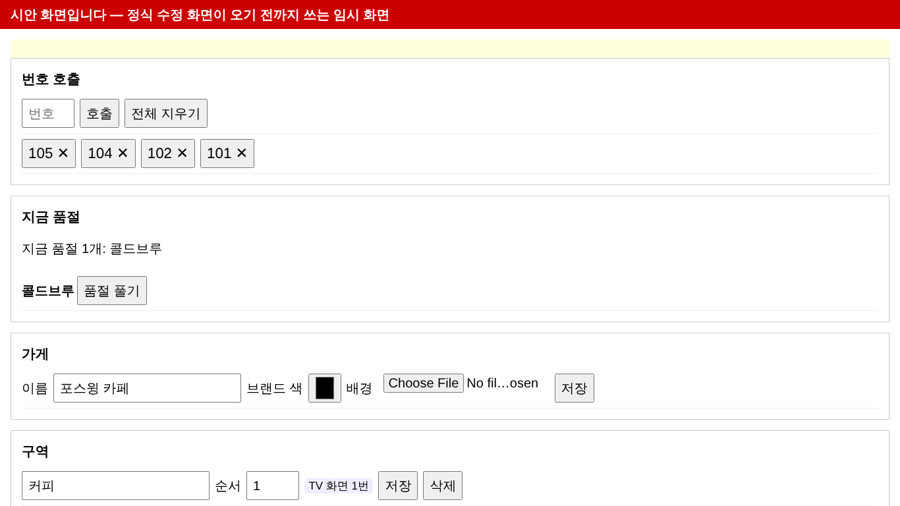 | 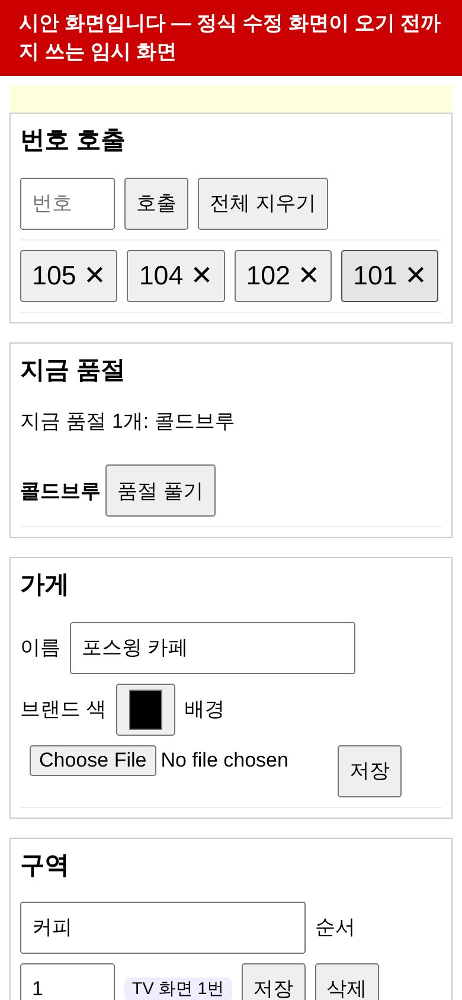 |

화면 맨 위 노란 줄에 방금 한 일의 결과(예: "저장했습니다. TV 1번 화면에 나옵니다")가 나옵니다. **무엇을 누른 뒤에는 이 줄을 한 번 보세요.**

---

## 3. 번호 부르기

음식이 준비되면 번호표의 번호를 TV에 띄웁니다. 손님은 TV의 빨간 칸에서 자기 번호를 봅니다.

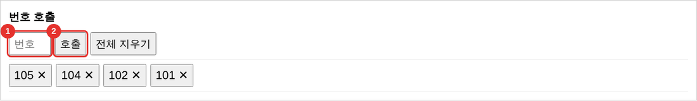

1. ① **번호** 칸에 번호표 번호(예: 105)를 넣습니다.
2. ② **호출**을 누릅니다(또는 Enter). TV에 바로 뜹니다.
3. 잘못 불렀으면 아래 목록에서 그 번호의 **×** 를 누릅니다. TV에서 바로 빠집니다.
4. 같은 번호를 다시 호출하면 맨 앞으로 와 다시 크게 나옵니다(손님이 안 오실 때).
5. 부른 번호는 **10분 뒤 저절로** TV에서 빠집니다. **전체 지우기**는 한 번 더 묻고 모두 지웁니다.

| 메뉴판 아래 번호 띠 | 번호 전용 TV |
| --- | --- |
| 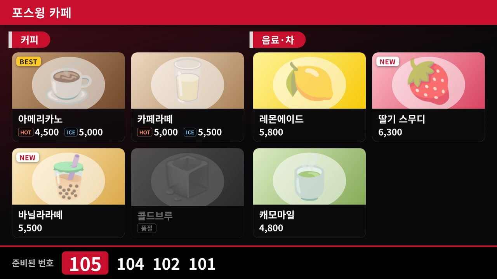 | 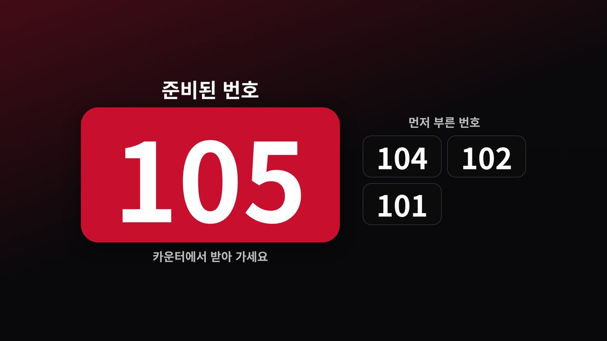 |

### 번호 키패드로 부르기

POS기 오른쪽 아래의 좁은 번호 창이 키패드를 받습니다. **판매 프로그램을 쓰는 중에도** 키패드만 치면 됩니다(판매 프로그램 칸에는 숫자가 들어가지 않습니다).

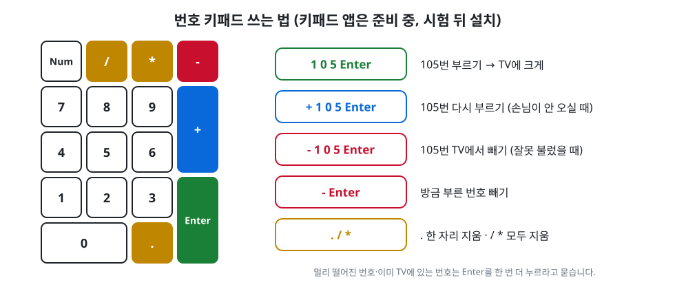

| 하고 싶은 것 | 키패드 | 번호 창 단추 |
| --- | --- | --- |
| 부르기 | `1` `2` Enter | 숫자 → 부르기 |
| 다시 부르기(손님이 안 오실 때) | `+` `1` `2` Enter, 맨 앞 번호면 `+` Enter | 목록에서 번호 → "12번 다시" |
| 잘못 부른 번호 빼기 | `-` `1` `2` Enter, 맨 앞 번호면 `-` Enter Enter | 목록에서 번호 → "12번 빼기" |
| 한 자리 지우기 / 모두 지우기 | `.` 또는 Backspace / `*` 또는 `/` | ⌫ / 지움 |

- 창이 **주황색**으로 묻고 소리가 나면: 멀리 떨어진 번호(예: 101 다음 201)나 이미 TV에 있는 번호입니다. 맞으면 **Enter 한 번 더**, 틀렸으면 `.` 로 고칩니다.
- 창이 **붉어지고** "못 보낸 번호"가 보이면: POS기 서버와 잠깐 끊긴 것입니다. 돌아오면 저절로 보냅니다. 2분 넘게 못 보낸 번호는 버리고 알려 주니 필요하면 다시 부릅니다.
- Num Lock 불이 꺼져 있어도 됩니다. 창을 닫아도(X) 작게 줄어들 뿐 계속 받습니다.
- 뺀 번호를 되돌리려면 그 번호를 다시 부르면 됩니다.

---

## 4. 메뉴·사진·가격 바꾸기

메뉴 한 줄은 이렇게 생겼습니다.

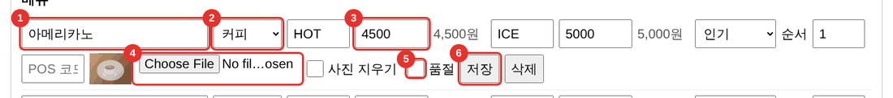

| 번호 | 칸 | 적는 법 |
| --- | --- | --- |
| ① | 이름 | TV에 나올 이름. **20자가 넘으면** 경고합니다(TV에서 잘림) |
| ② | 구역 | 이 메뉴가 들어갈 묶음 |
| ③ | 가격 | 숫자만(`4500`). `4,500` 이나 `4500원` 으로 적어도 숫자만 골라 씁니다. 옆에 "4,500원"으로 보입니다 |
| | 이름표 + 가격2 | HOT/ICE, 레귤러/라지처럼 가격이 둘일 때만. 하나면 비워 둡니다 |
| ④ | 사진 | **파일 선택**(시험 화면에서는 "Choose File")을 눌러 휴대폰 사진을 고릅니다. 큰 사진도 알아서 줄여 올립니다 |
| ⑤ | 품절 | 체크하면 **바로** TV에 "품절" (5절) |
| ⑥ | 저장 | **그 줄만** 저장합니다 |
| | 딱지 | 인기(BEST)·신메뉴(NEW) |
| | 순서 | 작은 숫자가 앞에 나옵니다 |

### 고치는 순서

1. 고칠 줄에서 칸을 고칩니다.
2. **그 줄의 저장**을 누릅니다. 저장하는 동안 단추가 잠깁니다(두 번 눌러도 한 번만 저장).
3. 노란 줄에 "TV ○번 화면에 나옵니다"가 뜨면 끝입니다. TV에는 보통 1초 안에 바뀝니다.
   - "**어느 화면에도 없습니다**"가 뜨면 그 구역이 TV 화면 구성에 빠진 것입니다(6절).
   - "**사진이 없어 격자 화면엔 안 나옵니다**"가 뜨면 사진을 넣습니다.

### 새 메뉴 넣기

메뉴 칸 **맨 아래 빈 줄**에 적고 **추가**를 누릅니다.

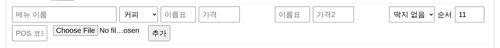

### 사진 잘 찍는 법

- **가로로** 찍습니다. TV 칸이 가로로 넓습니다.
- 음식을 가운데에, 글자가 박힌 사진은 피합니다(가장자리가 잘릴 수 있음).
- 아이폰 사진이 안 열리면: 아이폰 **설정 → 카메라 → 포맷 → 높은 호환성**으로 바꾸고 다시 찍습니다.
- 사진을 빼려면 **사진 지우기**에 체크하고 저장합니다.
- 고른 즉시 작은 미리보기가 나옵니다. 누워 있으면 저장하지 말고 다른 사진을 고릅니다.

### 메뉴 지우기

그 줄의 **삭제** → 한 번 더 묻습니다. **지운 메뉴는 되돌리는 단추가 없습니다**(7절 참고). 잠깐 안 팔 메뉴는 지우지 말고 **품절**로 두세요.

---

## 5. 품절

- 메뉴 줄의 **품절**에 체크하면 저장 단추 없이 **바로** TV에 회색 "품절"로 바뀝니다.
- 수정 화면 위쪽 **지금 품절** 칸에 품절인 메뉴가 모두 보입니다. **품절 풀기**로 바로 풉니다.

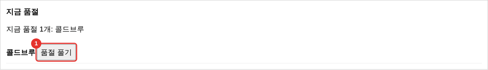

> **영업 전에 "지금 품절" 칸을 꼭 보세요.** 어제 켜 둔 품절은 풀 때까지 그대로입니다. "오늘만 품절"(다음 날 저절로 풀림)은 **[준비 중]** 입니다.

---

## 6. 구역과 TV 화면 구성

### 구역

구역은 메뉴를 묶는 이름입니다(커피, 음료·차, 디저트). 구역 옆에 어느 TV 화면에 나오는지 보입니다.

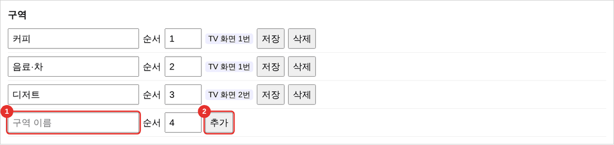

- 새 구역은 맨 아래 빈 줄에 이름을 쓰고 **추가**.
- **메뉴가 들어 있는 구역은 지울 수 없습니다.** 메뉴를 다른 구역으로 옮기거나 지운 뒤에 지웁니다(실수로 메뉴가 통째로 사라지지 않게).

### 화면 구성

TV마다 화면 번호(1~4)가 있습니다(TV 뒤 라벨). 번호마다 무엇을 띄울지 정합니다.

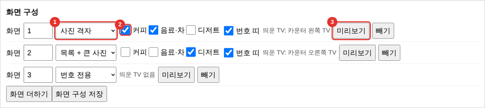

1. ① 화면 종류: **사진 격자**, **목록 + 큰 사진**, **번호 전용**, 홍보.
2. ② 이 화면에 넣을 구역에 체크합니다. **번호 띠**에 체크하면 메뉴판 아래에 준비된 번호가 나옵니다.
3. 옆에 "띄운 TV: 카운터 왼쪽 TV"처럼 이 화면을 띄운 TV가 보입니다.
4. **화면 구성 저장**을 누릅니다.
5. ③ **미리보기**로 TV에 어떻게 나오는지 봅니다(저장한 모습만 보입니다).

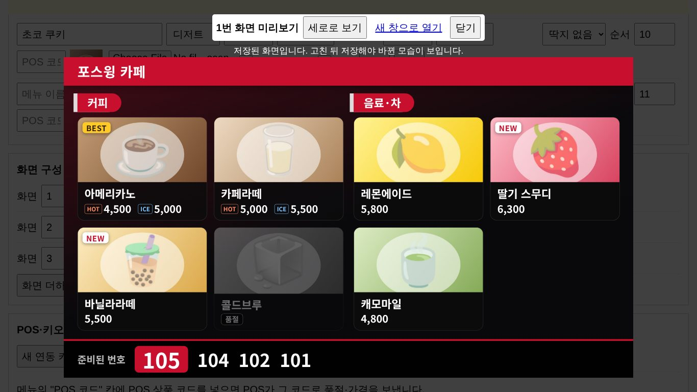

- TV가 쓰고 있는 화면을 **빼기** 하면 "카운터 왼쪽 TV가 이 화면을 띄우고 있습니다"처럼 한 번 더 묻습니다.
- TV가 없는 화면 번호를 띄우고 있으면 이 칸에 경고가 나옵니다. 그 TV에는 매장 이름만 크게 나옵니다.

---

## 7. 자주 하는 실수와 되돌리기

### 메뉴 고칠 때

| 이런 일 | 화면이 막아 주는 것 | 이렇게 하세요 |
| --- | --- | --- |
| 가격에 0을 하나 더 넣음(4,500 → 45,000) | "4,500원 → 45,000원, 맞나요?" 하고 묻습니다. 100원 단위가 아니거나 0원이어도 묻습니다 | **취소**를 누르고 고칩니다. 새 메뉴는 비교할 전 가격이 없어 묻지 않으니 옆의 "○○원" 표시를 꼭 봅니다 |
| 여러 줄을 고치고 한 줄만 저장 | "저장하지 않은 다른 수정이 N곳 있습니다" 하고 묻습니다 | **취소** → 고친 줄마다 **저장**을 누릅니다 |
| 저장을 두 번 누름 | 저장 중에는 단추가 잠깁니다 | 노란 줄의 결과를 기다립니다 |
| 메뉴를 넣었는데 TV에 안 나옴 | 저장 뒤 "어느 화면에도 없습니다" | 6절 화면 구성에서 그 구역에 체크 |
| 이름이 길어 TV에서 잘림 | 20자가 넘으면 경고 | 줄이고 **미리보기**로 확인 |
| 사진이 눕거나 잘림 | 고른 즉시 작은 미리보기 | 다른 사진을 고르거나 가로로 다시 찍기 |
| 구역을 지우려는데 안 지워짐 | 메뉴가 있는 구역은 지우기를 막음 | 정상입니다. 메뉴를 먼저 옮기세요 |
| TV가 쓰는 화면을 지움 | TV 이름까지 보여 주며 묻습니다 | 지웠다면 같은 번호로 화면을 다시 만들고 저장 |
| 사장님과 직원이 동시에 같은 메뉴를 고침 | 아직 못 막습니다 | **나중에 저장한 쪽**이 남습니다. 고친 뒤 TV를 한 번 보세요 |
| 영어 오류(`Failed to fetch` 등) | 일부만 한국어로 바뀌었습니다 | 화면을 새로 고쳐(F5) 저장됐는지 보고, 안 됐으면 다시 저장. 계속되면 A/S |

### 메뉴를 지워 버렸을 때

- **되돌리기 단추는 아직 없습니다**(휴지통은 **[준비 중]**).
- 매장 서버는 **하루에 한 번 자동 백업**을 하고 7일치를 보관합니다. A/S에 연락하시면 지우기 전날 백업으로 되돌려 드립니다. 다만 **그 뒤에 고친 내용은 다시 고쳐야** 하니, 지운 메뉴가 적으면 새로 넣는 편이 빠릅니다.

### 번호 부를 때

| 이런 일 | 이렇게 하세요 |
| --- | --- |
| 다른 번호를 부름(12 대신 21) | 키패드 `-` `2` `1` Enter(방금 부른 번호면 `-` Enter Enter) 또는 수정 화면에서 그 번호의 **×**. 그리고 맞는 번호를 부릅니다 |
| 같은 번호를 연달아 부름 | 3초 안이면 한 번만 띄웁니다. 그 뒤면 맨 앞으로 와 다시 크게 나올 뿐입니다 |
| 손님이 안 와서 다시 알리고 싶음 | 키패드 `+` 번호 Enter, 또는 수정 화면에서 같은 번호를 다시 **호출**. 맨 앞에 크게 다시 나옵니다 |
| 어제 번호가 TV에 남음 | 부른 번호는 10분 뒤 저절로 빠집니다. 남아 있으면 **전체 지우기** |

### 매장에서

| 이런 일 | 이렇게 하세요 |
| --- | --- |
| 마감 때 멀티탭·차단기를 내림 | 괜찮습니다. 아침에 전원만 켜면 메뉴판이 저절로 뜹니다. 그래도 POS기는 되도록 **시작 → 전원 → 시스템 종료**로 끄세요 |
| 손님·직원이 TV 리모컨으로 입력을 바꿈 | 리모컨으로 입력(HDMI)을 메뉴판 쪽으로. 리모컨은 카운터 안쪽에 |
| TV에 설정 화면이 떠 있음 | 누가 리모컨 확인 버튼을 오래 누른 것입니다. 2분 뒤 저절로 메뉴판으로 돌아갑니다 |
| 공유기를 바꾸거나 와이파이 비밀번호를 바꿈 | **바꾸기 전에 A/S에 연락**하세요. 천장 TV가 끊길 수 있습니다 |
| 손님에게 매장 와이파이 비밀번호를 알려 줌 | 손님에게는 **게스트 와이파이**만 알려 주세요 |
| 백신(V3·알약)이 "위험한 파일"·"키로거"라며 치료하자고 함 | **치료하지 말고** A/S에 연락하세요(메뉴판 서버나 번호 키패드 앱을 오인한 것일 수 있음) |
| 키패드를 눌러도 TV에 안 나옴 | 번호 창이 붉은지 보세요(서버 끊김). 창이 안 보이면 POS기를 다시 시작하세요. 그래도 안 되면 A/S |
| 그만둔 직원이 비밀번호를 앎 | 8절대로 비밀번호를 바꾸면 모든 휴대폰·PC가 로그아웃됩니다. 키패드·POS 연동 키도 바꿔야 하니 A/S에 함께 말씀하세요. 직원별 계정은 **[준비 중]** |

---

## 8. 비밀번호를 잊었을 때

**POS기에서만** 다시 정할 수 있습니다(휴대폰·다른 컴퓨터에서는 막혀 있어 안전합니다).

1. POS기 브라우저 주소창에 `http://127.0.0.1:8090/reset.html`
2. 계정(이메일)을 고르고 새 비밀번호를 두 번 넣습니다(8자 이상).
3. **비밀번호 바꾸기** → 그 계정으로 로그인해 있던 휴대폰·PC는 모두 로그아웃됩니다.

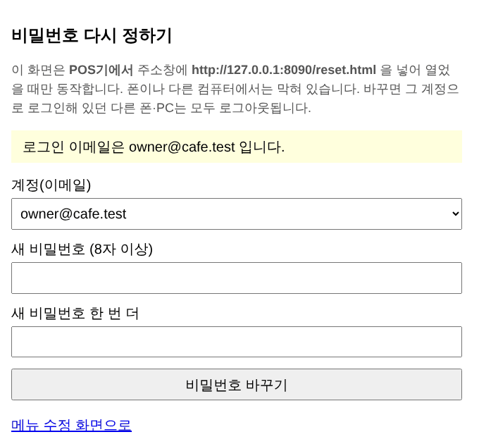

---

## 9. TV가 이상할 때

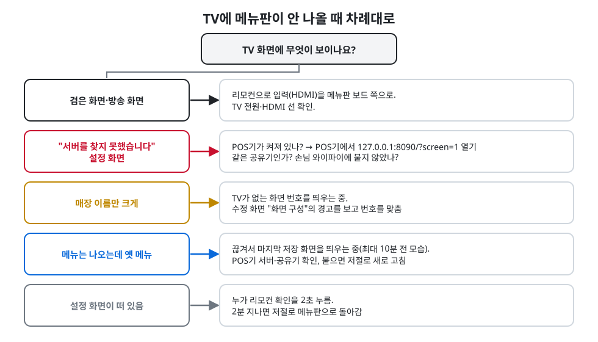

먼저 **POS기가 켜져 있는지** 보세요. 메뉴판은 POS기에서 나옵니다. POS기가 꺼져 있으면 TV는 마지막으로 저장해 둔 화면을 보여 주다가(최대 10분 전 모습), POS기가 켜지면 저절로 새로 고칩니다.

---

## 10. 이것만은 하지 마세요

- `C:\MenuBoard` 폴더를 지우거나 옮기지 마세요. 메뉴·사진·백업이 모두 여기에 있습니다.
- 백신이 메뉴판 서버(`pocketbase.exe`)를 치료하겠다고 해도 **치료하지 마세요.**
- 공유기를 바꾸거나 초기화하기 전에 A/S에 먼저 연락하세요.
- TV 리모컨을 손님 손이 닿는 곳에 두지 마세요.
- 비밀번호를 TV 옆이나 POS기에 붙여 두지 마세요.

---

## 11. A/S 연락

```
POSWING A/S: ____________________   (설치 기사가 적어 드립니다)
수정 화면 주소(휴대폰): http://_______________:8090/admin.html
TV 위치와 화면 번호:  1 ________  2 ________  3 ________  4 ________
```

연락하실 때 알려 주시면 빨리 해결됩니다.

1. 매장 이름
2. 어느 TV인지(TV 뒤 라벨의 화면 번호)
3. TV 화면을 휴대폰으로 찍은 사진
4. 언제부터, 무엇을 한 뒤에 그랬는지(예: "공유기를 바꾼 뒤부터")
