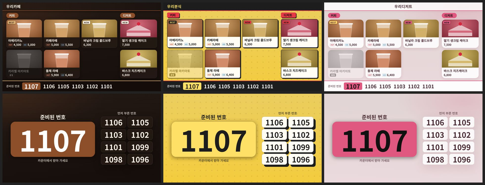

# 메뉴판 테마 시작 키트 (UI팀용)

TV 메뉴판의 **배치는 개발팀**, **색·모양은 UI팀**이 맡습니다.
UI팀은 코드를 고치지 않고 **테마 파일 하나**(`server/pb_public/themes/<이름>.css`)를 더해서 업종별 모습을 만듭니다.
사진 자동 맞춤, 글 넘침 줄이기, 품절 흐림, 4K·세로 화면, 번호 띠 자리는 개발팀이 만든 화면(`index.html`)이 알아서 합니다.



| 테마 | 이름(`id`) | 바탕 | 어울리는 업종 |
|---|---|---|---|
| 카페 · 따뜻한 원목 | `cafe` | 어두움 | 커피, 베이커리 |
| 분식 · 활기찬 노랑 | `bunsik` | 밝음 | 분식, 치킨, 패스트푸드 |
| 디저트 · 파스텔 | `dessert` | 밝음 | 디저트, 빙수, 아이스크림 |

화면마다 스크린샷은 [screens/](screens/)에 있습니다(가로 1920×1080, 세로 1080×1920, 4K 3840×2160, 글자 배율 150%).

## 1. 테마가 하는 일과 못 하는 일

```
 ┌───────────── index.html (개발팀) ─────────────┐      ┌── themes/cafe.css (UI팀) ──┐
 │ 배치: 격자·목록·홍보·번호 화면, 번호 띠       │ ◀──  │ :root {                    │
 │ 크기: 화면 긴 변 비례, 4K·세로, 넘치면 줄이기 │ 값만 │   --base: #1b1310;          │
 │ 동작: 새 번호 깜빡임, 품절 흐림, 사진 맞춤     │ 바꿈 │   --radius: 1.1em; ...      │
 │ 색·모양은 모두 var(--테마 값)으로 씀           │      │ }                          │
 └────────────────────────────────────────────────┘      └────────────────────────────┘
```

- **할 수 있는 것**: 아래 표의 테마 값(색, 바탕 무늬, 모서리, 테두리, 그림자, 매장 이름 위치, 굵기)을 바꾸기.
- **못 하는 것**: 글자 크기·칸 수·여백·위치 바꾸기, 요소 숨기기·더하기, 다른 선택자(`.card {…}`) 쓰기, 바깥 인터넷 주소의 그림·글꼴.
  배치를 바꾸고 싶으면 개발팀에 요청합니다(4K·세로·배율 150%에서 글이 잘리지 않는지 개발팀이 책임지기 때문).
- **사장님 브랜드 색**: `var(--brand)`로 쓸 수 있고, 그 위 글자색은 `var(--on-brand)`(화면이 흰색·검은색 중 잘 보이는 쪽을 고름)로 씁니다.
  테마가 `--brand`를 바꾸지는 못합니다. 사장님이 노랑을 골라도 빨강을 골라도 어울리게 만드는 것이 테마의 일입니다.

## 2. 건드려도 되는 파일 / 건드리면 안 되는 파일

| 파일 | UI팀 |
|---|---|
| `server/pb_public/themes/<새 이름>.css` | ✅ 새로 만듦 |
| `server/pb_public/themes/list.json` | ✅ 한 줄 더함 |
| `server/pb_public/themes/<그림 파일>` (바탕 무늬 등) | ✅ 더함 (한 장 300KB 이하, 검사가 막음) |
| `docs/themes/` 안내·스크린샷 | ✅ 고침 |
| `server/pb_public/index.html` | ❌ 개발팀 (배치·테마 값 목록) |
| `server/pb_public/api.js`, `board.js` | ❌ 개발팀 (서버 연결) |
| `server/pb_public/admin.html`, `devices.html` | ❌ 개발팀 (수정 화면) |
| `server/pb_hooks/`, `server/pb_migrations/` | ❌ 서버 |
| `board-app/`, `order-app/` | ❌ TV 앱, 번호 처리 앱 |
| `ui-prompt.md` | ❌ 화면 계약 (바꾸고 싶으면 제안) |

## 3. 테마 값 목록

기본값은 `index.html`의 `:root`에 있습니다(테마가 없을 때의 모습). 테마는 바꾸고 싶은 것만 적으면 나머지는 기본값을 씁니다.

| 값 | 무엇 | 기본값 |
|---|---|---|
| `--font` | 글꼴 목록 | Pretendard, Noto Sans KR … (보드에는 Noto Sans CJK만 있음) |
| `--weight` | 글 굵기 | `700` (보드에서 확실한 굵기는 400·700뿐) |
| `--ink` / `--muted` | 기본 글자 / 보조 글자 | 흰색 / 흰색 72% |
| `--base` | 바탕색 | `#0b0b0d` |
| `--veil` | 매장 배경 사진 위에 덮는 막 | 검은 반투명 그라데이션 |
| `--glow` / `--glow-opacity` | 막 위 빛·무늬(`background` 값, 그라데이션이나 `url(무늬.png)`) / 진하기 | 브랜드 색 빛 / `.3` |
| `--panel` / `--line` | 카드·목록 상자 바탕 / 선 | 검은 74% / 흰 16% |
| `--radius` | 카드·상자 모서리 | `.8em` |
| `--card-border` / `--card-shadow` | 카드 테두리 / 그림자 | 얇은 선 / 없음 |
| `--photo-bg` | 사진 뒤 바탕 | 검정 |
| `--top-bg` / `--top-ink` / `--top-line` / `--top-shadow` | 맨 위 매장 이름 띠 바탕 / 글 / 아래 선 / 그림자 | 브랜드 색 / on-brand / 없음 / 그림자 |
| `--top-align` | 매장 이름 위치 (`flex-start` 왼쪽, `center` 가운데) | 왼쪽 |
| `--title-bg` / `--title-ink` / `--title-radius` / `--title-shadow` | 구역 제목 띠 | 브랜드 색 / on-brand / 오른쪽만 둥글게 / 왼쪽 흰 줄 |
| `--badge-new-bg` / `--badge-new-ink` | NEW 딱지 | 흰 / 브랜드 색 |
| `--badge-best-bg` / `--badge-best-ink` | BEST 딱지 | 노랑 / 진갈색 |
| `--hot` / `--ice` | 가격 이름표 HOT / ICE 색 | 주황 / 하늘 |
| `--sold-bg` / `--sold-ink` / `--sold-line` | 품절 표 | 검정 / 흰 / 흰 선 |
| `--caption-bg` / `--caption-ink` | 목록형 큰 사진 위 이름 | 아래 어두운 그라데이션 / 흰 |
| `--promo-shadow` | 홍보 문구 그림자 | 어두운 그림자 |
| `--band-bg` / `--band-ink` / `--band-muted` / `--band-line` | 번호 띠 바탕 / 번호 / "준비된 번호" 글 / 위 선 | 검정 82% / 흰 / 흰 72% / 브랜드 색 |
| `--call-bg` / `--call-ink` | **가장 최근 번호** 강조 (번호 띠·번호 전용 화면 공통) | 브랜드 색 / on-brand |

크기 단위는 `em`·`rem`만 씁니다(`px` 금지: 4K에서 반으로 작아짐).

## 4. 새 테마 만드는 순서

1. 가장 가까운 기본 테마를 복사합니다. 예: `themes/bunsik.css` → `themes/chicken.css`
   이름은 영어 소문자·숫자·`-`만(주소에 들어갑니다).
2. `themes/list.json`에 한 줄 더합니다.
   ```json
   { "id": "chicken", "name": "치킨 · 바삭한 주황", "kind": "dark", "sampleStore": "우리치킨", "sampleBrand": "#f77f00",
     "desc": "어두운 바탕에 주황 강조. 치킨·호프" }
   ```
   `kind`는 바탕이 밝은지(`light`) 어두운지(`dark`), `sampleStore`·`sampleBrand`는 스크린샷 찍을 때 쓰는 견본 매장 이름과 브랜드 색입니다.
3. 값을 바꿉니다. 밝은 바탕이면 `--ink`, `--muted`, `--veil`, `--band-*`을 함께 바꿔야 글이 보입니다(`dessert.css` 참고).
4. 미리 봅니다.
   - 서버를 켠 개발 환경(`start-server.bat`)에서 `http://127.0.0.1:8090/?screen=1&theme=chicken`
     (`screen=` 1~4를 바꿔 가며, `&zoom=150`도). 저장하고 새로 고치면 바로 바뀝니다.
   - 브라우저 개발자 도구의 기기 크기에서 1920×1080, 3840×2160, 1080×1920을 모두 봅니다.
5. 검사를 돌립니다(`digital-menu/server/`에서).
   ```
   node check_themes.js                 테마 파일 규칙·글자 대비 (몇 초)
   node check_screens.js shots chicken  3가지 크기 × 배율 2 × 화면 6개, 잘린 글 검사와 스크린샷 (server/shots/chicken/)
   ```
   둘 다 `모두 통과`가 나와야 합니다. `check_screens.js`는 Playwright가 필요합니다(`npm i -g playwright` 후 `npx playwright install chromium`).
6. 스크린샷 몇 장을 `docs/themes/screens/`에 jpg로 넣고, PR을 올립니다. PR 설명에 3번 확인 목록을 붙입니다.

## 5. 확인 목록 (PR마다)

- [ ] `check_themes.js`, `check_screens.js` 모두 통과
- [ ] 번호 띠의 **가장 최근 번호**가 3m 밖에서도 한눈에 보인다 (번호 호출이 1차의 핵심 기능)
- [ ] 번호 전용 화면: 번호가 있을 때와 없을 때(매장 이름 + 안내) 둘 다 봤다
- [ ] 품절 메뉴가 흐리게 보이고 "품절" 표가 읽힌다
- [ ] 브랜드 색을 빨강·노랑·남색 세 가지로 바꿔 봐도 어울린다 (수정 화면의 브랜드 색 또는 `sampleBrand`)
- [ ] 매장 배경 사진이 있을 때와 없을 때 모두 글이 잘 보인다
- [ ] 세로 화면, 4K, 글자 배율 150%
- [ ] `index.html`·`api.js`·`board.js`를 고치지 않았다

## 6. 매장에서 테마를 고르는 방법

- **지금**: 주소 뒤 `&theme=<이름>`으로만 고릅니다(미리 보기·시험용). 테마 파일이 없거나 이름이 틀리면 기본 모습으로 나옵니다.
- **다음 단계(제안, 아직 안 됨)**: 화면 계약에 `store.theme`(테마 이름 문자열, 없으면 `null`)을 더하고,
  수정 화면의 매장 설정에서 사장님이 고르게 합니다. 화면(`index.html`)은 이미 `store.theme`이 오면 그 테마를 씁니다.
  서버 필드와 수정 화면은 개발팀이 만듭니다.

## 7. UI 담당자의 AI에 붙여 넣을 작업 지시

[ai-prompt.md](ai-prompt.md)를 통째로 Claude나 GPT에 붙여 넣고, 맨 아래 "이번에 만들 테마"만 바꿔 쓰면 됩니다.
